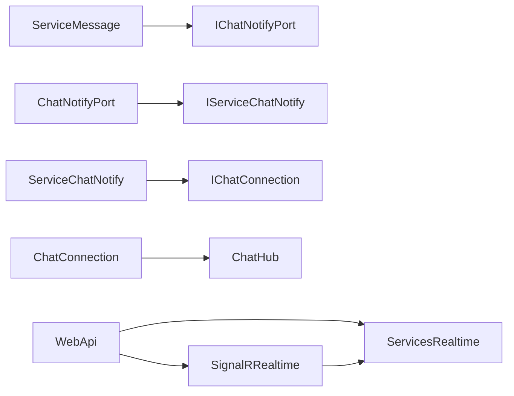

[← Реестр задач](../tasks.md)

**Описание:**

Realtime для чата через SignalR: участники открытого чата сразу видят изменения ленты сообщений и состава/ролей участников без ручного обновления. Область `Realtime` выделена отдельно (как `Messaging` / `Files`): контракты без ASP.NET и транспорт SignalR в своём проекте; `Socium` не ссылается на Realtime — только порт и адаптер в WebApi.

**Функциональные требования:**

1. Лента: при открытом чате новые / изменённые / удалённые сообщения появляются у других участников без перезагрузки — [События](#события).
2. Пагинация ленты: при открытии — последние 50 сообщений; скролл вверх / «ещё» — подгрузка более старых порциями по 50 — [Пагинация сообщений](#пагинация-сообщений).
3. Панель участников: вход, выход и смена роли видны остальным в открытом чате без перезагрузки — [События](#события).
4. Подключение: клиент входит в группу чата после открытия окна; при закрытии / смене чата — выход из группы; доступ только участнику чата.
5. Аутентификация: тот же JWT, что у REST; неавторизованный / чужой чат — отказ Join.
6. Переподключение: после обрыва — снова последние 50 сообщений и список участников, локальная история сбрасывается — [Reconnect](#reconnect).

**Технические требования:**

1. Раскладка — в [Структура](#структура): area `Realtime/` с `Services.Realtime` (без ASP.NET, без БД) и `SignalR.Realtime` (хаб и bridge); в `Solution-Socium.slnx` — папка `/Realtime/`.
2. Связь областей: `Socium` не ссылается на `Realtime`; порт `IChatNotifyPort` в `Services.Socium/Ports/`, адаптер `ChatNotifyPort` в `WebApi/Ports/` вызывает `IServiceChatNotify` — [Зависимости](#зависимости), [Имена](#имена).
3. Абстракция транспорта: `IChatConnection` в `Services.Realtime`; реализация `ChatConnection` в `SignalR.Realtime` через `IHubContext<ChatHub>` — сервисы не ссылаются на ASP.NET (rule-0003).
4. Payload: свои модели в `Services.Realtime/Models` (не `MessageListModel` Socium); маппинг Socium → Realtime в адаптере WebApi.
5. Хаб: `ChatHub`, маршрут `/hubs/chat`, группа `chat:{chatId}`; `JoinChat` / `LeaveChat` с проверкой участника.
6. Host: `AddSignalR`, `MapHub`, JWT для SignalR — только wiring в `WebApi` (`Program` / Middleware); класс хаба в `SignalR.Realtime`, не в Controllers.
7. Вызов notify: после успешного `SaveChanges` в сервисах сообщений и участников — через порт; сбой notify не откатывает уже сохранённое (зафиксировать в runbook при необходимости).
8. Список сообщений REST: вместо «все сразу» — страница последних N (N = 50) и курсор «старше чем» (`beforeId` / эквивалент) для прошлых порций — [Пагинация сообщений](#пагинация-сообщений).
9. Фронтенд: клиент SignalR, Join/Leave, обновление ленты и участников; подгрузка истории вверх; после reconnect — сброс к свежим 50.
10. Тесты: unit/integration на notify, paging и отказ Join для не-участника; E2E — второй клиент видит новое сообщение / подгрузка истории по возможности окружения.
11. Документы: rule-0003 — область `Realtime`, `Services.Realtime`, `SignalR.Realtime`, порт `IChatNotifyPort`; runbook — хаб, JWT, paging.

**План реализации:**

1. Карточка и реестр.
2. `Services.Realtime`: модели событий, `IChatConnection`, `IServiceChatNotify` / `ServiceChatNotify`.
3. `SignalR.Realtime`: `ChatHub`, `ChatConnection`; проекты в solution.
4. WebApi: `AddSignalR`, `MapHub("/hubs/chat")`, JWT для хаба; адаптер `ChatNotifyPort`.
5. Socium: paging списка сообщений (50 + before); `IChatNotifyPort`; вызовы из `ServiceMessage` и сервиса участников после успешного сохранения.
6. Фронтенд: соединение, Join/Leave, лента с подгрузкой вверх, панель участников, reconnect со сбросом к 50.
7. Тесты; rule-0003 и runbook.

**Выполнено:**

1. Создана карточка `docs/tasks/task-0014.md`, задача добавлена в реестр `docs/tasks.md`.
2. Область `Realtime/`: `Services.Realtime` и `SignalR.Realtime` (`ChatHub`, `ChatConnection`); проекты в solution.
3. WebApi: `AddSignalRRealtime` / `AddRealtime`, `MapHub("/hubs/chat")`, JWT `access_token` для `/hubs`, адаптеры `ChatNotifyPort` и `ChatMembershipPort`.
4. Socium: `IChatNotifyPort`; notify из `ServiceMessage` и `ServiceParticipant`; paging списка сообщений (50 + `beforeId`, `HasOlder`).
5. Фронтенд: `@microsoft/signalr`, `app/realtime/chat-hub`, лента с подгрузкой вверх и reconnect, панель участников на событиях, proxy `/hubs`.
6. Тесты списка/paging и ChatMessages; `rule-0003` (Realtime), runbook `realtime.md`.

**Дополнительные сведения:**

### Решения разработчика

| Вопрос | Решение |
|--------|---------|
| Карточка | Новая 0014 |
| Граница | Отдельная area `Realtime`, не порт/хаб «внутри» Socium и не смешение хаба с Controllers |
| Библиотеки | `Services.Realtime` + `SignalR.Realtime` (не одна смесь в WebApi) |
| Почему не Hub в `Services.*` | rule-0003: сервисы не ссылаются на ASP.NET |
| Имя проекта с хабом | `SignalR.Realtime` (не `Services.*`) |
| Socium ↔ Realtime | Порт `IChatNotifyPort` + адаптер WebApi |
| БД / миграции | Нет — Realtime без Datasource |
| Backplane (Redis) | Не в этой задаче |
| Участники в realtime | Да: вход / выход / смена роли — вместе с лентой сообщений |
| Пагинация сообщений | Последние 50 при открытии; подгрузка прошлых по 50 (`beforeId`) — в этой задаче |
| Участники: paging | Нет — полный список открытого чата |
| Reconnect | GET последних 50 + участники; локальную историю сбросить до этих 50 — [Reconnect](#reconnect) |
| Умный reconnect / сохранение старых страниц | Отказались — [Отложенный reconnect](#отложенный-reconnect) |

### Структура

```text
src/backend/SociumApp/
  Realtime/
    Services.Realtime/                 # без ASP.NET, без БД
      Api/
        IServiceChatNotify.cs          # публичный API area для адаптера
        ServiceChatNotify.cs
        IChatConnection.cs             # абстракция «отправить в группу чата»
      Models/
        ChatMessageNotifyModel.cs      # payload сообщений (не MessageListModel Socium)
        ChatMessageDeletedModel.cs
        ChatParticipantNotifyModel.cs  # вход / выход / смена роли
      Texts/
        ChatNotifyTexts.cs             # при необходимости (ошибки Join и т.п.)

    SignalR.Realtime/                  # единственное место с пакетом SignalR
      Hubs/
        ChatHub.cs                     # JoinChat / LeaveChat
      Api/
        ChatConnection.cs              # IChatConnection → IHubContext<ChatHub>

  Socium/
    Services.Socium/
      Ports/
        IChatNotifyPort.cs             # Socium не ссылается на Realtime
      Api/
        ServiceMessage.cs              # после успешного Save → порт

  WebApi/
    Ports/
      ChatNotifyPort.cs                # IChatNotifyPort → IServiceChatNotify
    Program.cs / Middleware            # AddSignalR, MapHub("/hubs/chat"), JWT
    # ChatHub сюда не кладём — только host wiring
```

### Зависимости

```text
ServiceMessage → IChatNotifyPort
ChatNotifyPort → IServiceChatNotify
ServiceChatNotify → IChatConnection
ChatConnection → ChatHub

WebApi → SignalR.Realtime
WebApi → Services.Realtime
SignalR.Realtime → Services.Realtime
Services.Socium ↛ Realtime (только порт)
```



### Имена

| Что | Имя |
|-----|-----|
| Area | `Realtime` |
| Контракты / notify-сервис | `Services.Realtime` |
| Хаб + bridge | `SignalR.Realtime` |
| Порт у Socium | `IChatNotifyPort` |
| Адаптер | `ChatNotifyPort` |
| Сервис area | `IServiceChatNotify` / `ServiceChatNotify` |
| Абстракция отправки | `IChatConnection` / `ChatConnection` |
| Хаб | `ChatHub` |
| Маршрут | `/hubs/chat` |
| Группа | `chat:{chatId}` |

### События

| Событие | Когда | Кому |
|---------|--------|------|
| messageCreated | после успешного создания сообщения | группа `chat:{chatId}` |
| messageUpdated | после успешного редактирования | группа `chat:{chatId}` |
| messageDeleted | после успешного удаления | группа `chat:{chatId}` |
| participantJoined | после успешного вступления в чат | группа `chat:{chatId}` |
| participantLeft | после успешного выхода | группа `chat:{chatId}` |
| participantRoleChanged | после успешной смены роли | группа `chat:{chatId}` |

### Пагинация сообщений

Сейчас `GET` списка отдаёт все сообщения чата. В этой задаче:

| Параметр | Значение |
|----------|----------|
| Размер страницы | 50 |
| Первая загрузка | последние 50 (самые новые) |
| Подгрузка | сообщения **старше** самого старого уже загруженного (`beforeId` или `beforeCreatedAt` + `beforeId`) |
| Направление в UI | скролл вверх / «загрузить ещё» |
| SignalR `messageCreated` | добавить к «хвосту» локального списка (или индикатор «↓ новые», если пользователь ушёл вверх — по возможности в реализации) |

Участники без paging: один полный список на открытый чат.

### Reconnect

Пока соединение живо — события идут по SignalR. После обрыва клиент мог пропустить события. В этой задаче:

1. Снова `Join` группы чата (если ещё открыт).
2. `GET` последних 50 сообщений и полный список участников.
3. **Сбросить** локальную ленту до этих 50 (уже подгруженные старые страницы не сохранять).

### Отложенный reconnect

Пока **отказались**, но можем вернуться отдельной задачей:

| Идея | Зачем | Почему не сейчас |
|------|--------|------------------|
| Сохранять уже подгруженные старые страницы после reconnect | Не терять прокрученную историю вверх | Сложнее слияние с свежим хвостом; при обрыве достаточно снова открыть «низ» чата |
| Синхронизация `since` / курсор / только пропущенные id | Меньше трафика, без полной замены окна | Нужны отдельные API и обработка дыр; при странице 50 простой GET достаточен |
| Не сбрасывать scroll-позицию в середину истории | UX «остался где был» | Следует из сохранения старых страниц |

### Вне объёма

Redis / scale-out backplane; typing indicators; presence «онлайн»; push вне открытого чата; realtime по комнатам/списку чатов; замена SignalR другим транспортом; saga/outbox для гарантированной доставки notify после SaveChanges; умный reconnect из [Отложенный reconnect](#отложенный-reconnect).
