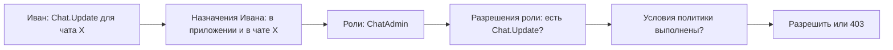
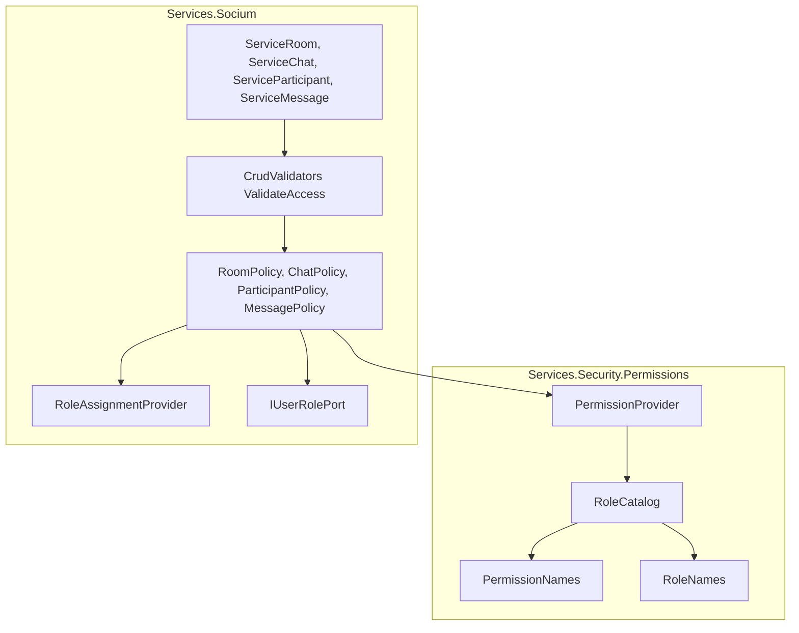
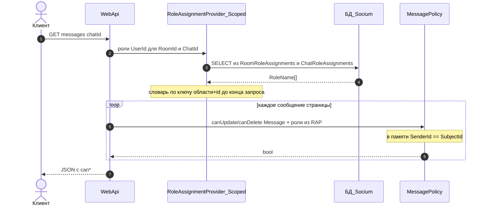
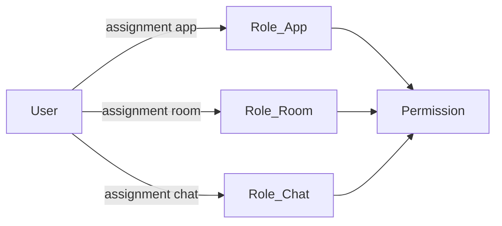

[← Реестр задач](../tasks.md)

**Описание:**

Ввести роли и права доступа на основе RBAC для сущностей комната, чат, участник и сообщение. Сначала согласуется концепция — термины, какие CRUD-разрешения нужны, какие роли их получают и из каких классов это состоит — без опоры на текущую логику проверок в коде. Хранение, проверки на API и UI — после утверждения таблиц. Ранее заводилась как [task-0019](task-0019.md) (отменена).

**Функциональные требования:**

1. Термины: субъект, ресурс, операция, разрешение, роль, область, назначение, условие, политика, инвариант и признаки `can*` различаются и называются единообразно — [Термины](#термины).
2. Области назначения: роль выдаётся в контексте приложения, комнаты или чата — [Области назначения](#области-назначения).
3. Разрешения: перечень CRUD-разрешений по комнате, админу комнат, чату, участнику и сообщению — [Таблица 1. Разрешения](#таблица-1-разрешения).
4. Роли: набор ролей и разрешения каждой роли — [Таблица 2. Роли и разрешения](#таблица-2-роли-и-разрешения).
5. Инварианты: правила, которые должны соблюдаться при любом назначении ролей — [Инварианты](#инварианты).
6. Кнопки в UI: кнопки действий видны и активны по признакам `can*` от сервера, а не по роли — [Решения разработчика](#решения-разработчика).
7. Иерархия админов: админ приложения создаёт комнаты и назначает админов комнат; при создании комнаты создатель получает `RoomAdmin` через Events; админ комнат управляет своей комнатой и назначает админов чатов; вести чаты — `ChatAdmin` (без `Includes`: вместе с `ChatParticipant` по инварианту) — [Таблица 2. Роли и разрешения](#таблица-2-роли-и-разрешения), [Инварианты](#инварианты).
8. Видимость: админ приложения — все комнаты; админ комнат — свои комнаты и чаты своей комнаты (не сообщения); участник чата — свой чат, комнату и ленту; админ чата ленту видит только имея ещё `ChatParticipant`; вошедший без назначений не видит ничего — [Таблица 2. Роли и разрешения](#таблица-2-роли-и-разрешения).

**Технические требования:**

1. Концепция: таблицы строятся от названий сущностей и операций (CRUD; для назначения роли — Grant / Revoke), не от текущих проверок в коде.
2. Имя разрешения: `{Сущность}.{Операция}`, например `Chat.Update`; имя роли — `{Область}.{Роль}`, например `Chat.Admin`; поля констант — плоские, без вложенных классов (`ChatUpdate`, `ChatAdmin`) — [Таблица 1. Разрешения](#таблица-1-разрешения), [Дерево классов](#дерево-классов).
3. Реализация: модель хранения назначений, проверки на API, UI назначения ролей и судьба текущего признака админа чата — после утверждения таблиц, отдельным шагом этой карточки.
4. Библиотека: каталог разрешений, каталог ролей, таблица «роль — разрешения» и провайдер проверки — в отдельном проекте `Security/Services.Security.Permissions` без доступа к БД, по образцу `Services.Security.Tokens` и `Services.Security.Passwords` (rule-0003 п. 42) — [Размещение](#размещение), [Дерево классов](#дерево-классов).
5. Назначения: кто какую роль где получил, хранит владелец данных — роли уровня приложения (`AppAdmin`) в БД Security, роли уровня комнаты и чата (`RoomAdmin`, роли чата) в БД Socium — [Размещение](#размещение).
6. Правила: на `Services.Security.Permissions` ссылаются `Services.Security` и `Services.Socium`; для `Services.Socium` при реализации добавить исключение в [rule-0003](../rules/rule-0003-backend.md) — [Размещение](#размещение).
7. Один источник имён: имя каждого разрешения и каждой роли объявлено один раз в каталоге библиотеки; строковые литералы ролей и разрешений в сервисах, сидах и конфиге не пишутся — [Принципы проектирования](#принципы-проектирования).
8. Место проверки: авторизация выполняется в сервисе на шаге `ValidateAccess*` (ответ `403`), а не только атрибутом контроллера — [Как проходит проверка](#как-проходит-проверка).
9. Токен: роли и разрешения в JWT не кладутся; права считаются на каждый запрос по назначениям из БД — [Принципы проектирования](#принципы-проектирования).
10. Ответы API: права текущего пользователя отдаются признаками `can*` (`CanUpdate`, `CanDelete`, …); роль текущего пользователя для решений на фронт не отдаётся; роль другого участника допускается только как данные для показа (отметка «админ») — [Решения разработчика](#решения-разработчика).
11. Политика: условие, зависящее от конкретного ресурса (например «ты отправитель сообщения»), — это политика поверх разрешения, а не отдельное разрешение — [Термины](#термины), [Дерево классов](#дерево-классов).
12. Условие выдачи: тип условия (`PermissionCondition`) задаётся у роли в `RoleCatalog` вместе с разрешением и проверяется в `PermissionProvider` по контексту проверки (`PermissionContext`) без доменных типов; политики в `Services.Socium` только переводят сущность в контекст проверки и не знают имён ролей — [Дерево классов](#дерево-классов), [Размещение](#размещение).
13. Разрешение на комнату у роли уровня чата действует для комнаты этого чата: `ChatParticipant` получает `RoomRead` только для комнаты, в которой лежит его чат — [Области назначения](#области-назначения).
14. Выход из чата — не разрешение (`ChatParticipant` в колонке «Назначения»): участник снимает у себя роль в этом чате; `ChatParticipantRevoke` — снятие роли с другого по id — [Таблица 2. Роли и разрешения](#таблица-2-роли-и-разрешения).
15. Админ комнат не читает сообщения **как** `RoomAdmin`: у него `RoomRead` / `Update` / `Delete`, `ChatCreate` / `ChatRead` и `ChatAdminGrant` / `Revoke` в своей комнате; ленту видит только с ролью `ChatParticipant` (например после создания чата). `RoomCreate` — у `AppAdmin` — [Таблица 2. Роли и разрешения](#таблица-2-роли-и-разрешения).
16. `ChatAdmin` не включает `ChatParticipant`: писать и читать ленту — только у `ChatParticipant`; `ChatAdmin` допустим только вместе с `ChatParticipant` в том же чате (обе роли в одной транзакции назначения) — [Таблица 2. Роли и разрешения](#таблица-2-роли-и-разрешения), [Инварианты](#инварианты).
17. Роли субъекта загружаются один раз на HTTP-запрос (scoped-словарь по контексту у `IRoleAssignmentProvider` / порта) и дальше считаются в памяти; отдельный SQL на каждый `can*` в ленте запрещён. Redis в первом срезе не обязателен — [Хранение и проверка](#хранение-и-проверка), [Принципы проектирования](#принципы-проектирования).
18. Первый чат: `ChatCreate` у `RoomAdmin` (область комнаты); после создания чата создателю в той же транзакции — `ChatAdmin` + `ChatParticipant` — [Инварианты](#инварианты).
19. Легаси `Participant.IsAdmin`: в конце внедрения — сначала таблицы и data-migration, затем переключение кода на назначения, затем drop столбца (не наоборот: иначе окно без прав) — [Хранение и проверка](#хранение-и-проверка).

**План реализации:**

1. ~~Наполнить концепцию~~ — сделано.
2. ~~Утвердить таблицы 1 и 2 и дерево классов~~ — сделано.
3. ~~Спроектировать хранение, миграцию `IsAdmin`, провайдер~~ — [Хранение и проверка](#хранение-и-проверка).
4. Реализация вертикальными шагами (несколько коммитов в одной задаче):
   1. `Services.Security.Permissions`: константы, `RoleCatalog`, `PermissionProvider` (без БД) + unit-тесты.
   2. Таблицы назначений (`AppRoleAssignments`, `RoomRoleAssignments`, `ChatRoleAssignments`) + scoped `RoleAssignmentProvider` / `IUserRolePort`.
   3. Сквозной срез Room: `RoomCreate` / `RoomPolicy` / Events → `RoomAdmin`.
   4. Chat + участники + сообщения (`can*` / `Sender`).
   5. Data-migration `IsAdmin` → переключение кода → drop столбца; тесты; карточка «Выполнена»; коммит.

**Выполнено:**

1. Создана карточка `docs/tasks/task-0021.md`, задача добавлена в реестр `docs/tasks.md` (вместо отменённой 0019).
2. Наполнена концепция: термины, области, таблицы 1–2, инварианты, дерево классов.
3. Согласовано размещение: `Services.Security.Permissions`, назначения у владельцев данных; ТТ4–ТТ6.
4. Термины, Access, `can*`, политики; ТТ7–ТТ11; условие `Sender`.
5. Условие в `RoleCatalog` / `PermissionProvider`, маппинг в Socium Policies; ТТ12.
6. Таблицы ролей и разрешений согласованы с разработчиком (иерархия, Grant/Revoke, видимость, выход, task-0027); ФТ7–ФТ8, ТТ13–ТТ14.
7. Открытые вопросы по таблицам закрыты; bootstrap создателя чата — [Инварианты](#инварианты) п. 3.
8. Таблица 1 — «Поле» / «Что даёт»; кто что может — таблица 2.
9. `RoomAdmin` — область комнаты; `RoomCreate` у `AppAdmin`; `RoomCreatedEvent`.
10. Без Includes у `ChatAdmin`; ТТ17 — роли один раз на запрос.
11. Шаг 3 зафиксирован: `ChatCreate` у `RoomAdmin`, три таблицы назначений, scoped-провайдер, cutover `IsAdmin` — [Хранение и проверка](#хранение-и-проверка).
12. План реализации — вертикальные шаги 4.1–4.5 (библиотека → назначения → Room → Chat/Message → миграция).
13. Шаг 4.1: библиотека `Services.Security.Permissions` + unit-тесты `PermissionProviderTests`.
14. Шаг 4.2: таблицы `AppRoleAssignments` / `RoomRoleAssignments` / `ChatRoleAssignments` (миграция `Task0021`), репозитории, `RoleAssignmentProvider`, `IUserRolePort` / `UserRolePort`, `IServiceAppRole`; DI; исключение rule-0003 п. 10.
15. Шаг 4.3: `RoomPolicy`, `ValidateAccess*`, `AssignRoomAdminOnRoomCreatedHandler`, `ServiceRoom` Create/Update/Delete/List/Info через RBAC, признаки `can*` в ответах и UI списка комнат.
16. Шаг 4.4: `ChatPolicy` / `MessagePolicy` / `ParticipantPolicy`; CreateStage → `ChatAdmin`+`ChatParticipant`; dual-read ролей из `Participant` до cutover; `can*` в чатах, сообщениях и UI; dual-write назначений при join/update/leave.
17. Шаг 4.5: миграция `Task0021Cutover` (backfill `ChatRoleAssignments` / repair админов / `RoomAdmin` / drop `Participants.IsAdmin`); dual-read убран; API `IsAdmin` — derived от `ChatAdmin`; фикстуры выдают `AppAdmin`.

**Дополнительные сведения:**

### Термины

Кто и над чем:


| Термин                 | Что это                                             | Пример в Socium                                                                    |
| ---------------------- | --------------------------------------------------- | ---------------------------------------------------------------------------------- |
| Субъект (Subject)      | Тот, кто выполняет действие                         | Пользователь Иван                                                                  |
| Ресурс (Resource)      | Конкретный объект, над которым выполняется действие | Чат «Обсуждение 1»                                                                 |
| Тип ресурса (сущность) | Вид ресурса                                         | Комната, Чат, Участник, Сообщение; для Grant/Revoke — целевая роль (`RoomAdmin`, `ChatAdmin`, `ChatParticipant`) |
| Операция (Operation)   | Что делают с ресурсом                               | Create, Read, Update, Delete; для назначения роли — Grant, Revoke                  |


Права и роли:


| Термин                           | Что это                                               | Пример                                                                |
| -------------------------------- | ----------------------------------------------------- | --------------------------------------------------------------------- |
| Разрешение (Permission)          | Пара «тип ресурса + операция»: право на одно действие | `Chat.Update`                                                         |
| Роль (Role)                      | Именованный набор разрешений                          | «Админ чата» = `Chat.Create` + `ChatParticipant.Grant` + …             |
| Иерархия ролей                   | Одна роль включает все разрешения другой (`Includes`) | В первом срезе не используется: `ChatAdmin` не включает `ChatParticipant` |
| Область (Scope)                  | Где действует роль                                    | Приложение, комната, чат                                              |
| Назначение роли (RoleAssignment) | Факт «кому, какая роль, где»                          | Иван — «Админ чата» в чате «Обсуждение 1»                             |


Правила проверки:


| Термин                                | Что это                                                                                                                                  | Пример                                                 |
| ------------------------------------- | ---------------------------------------------------------------------------------------------------------------------------------------- | ------------------------------------------------------ |
| Условие (Condition)                   | Дополнительное требование помимо роли; зависит от конкретного ресурса; задаётся у роли вместе с разрешением (`PermissionCondition`)      | «Ты отправитель этого сообщения»                       |
| Отправитель (Sender)                  | Пользователь, отправивший сообщение (`Message.Sender.UserId`); единственное условие выдачи в первом срезе — `PermissionCondition.Sender` | Иван отправил сообщение — он его отправитель           |
| Контекст проверки (PermissionContext) | Данные одной проверки разрешения: кто действует и кто отправитель; без доменного типа                                                    | `SubjectId` = Иван, `SenderId` = отправитель сообщения |
| Политика (Policy)                     | Правило решения: разрешение + условия                                                                                                    | «Изменить сообщение» = `Message.Update` + отправитель  |
| Инвариант                             | Правило данных, которое нельзя нарушить никаким назначением                                                                              | В чате всегда есть хотя бы один админ                  |


Вокруг проверки:


| Термин                            | Что это                                                         | Пример                                                     |
| --------------------------------- | --------------------------------------------------------------- | ---------------------------------------------------------- |
| Контроль доступа (Access control) | Общее название всей области; RBAC — Role-Based Access Control   | Весь процесс «можно ли Ивану это действие»                 |
| Аутентификация (Authentication)   | Кто ты — проверка входа                                         | JWT подтверждает, что это Иван ([task-0011](task-0011.md)) |
| Авторизация (Authorization)       | Что тебе можно — проверка прав; предмет этой карточки           | Может ли Иван переименовать этот чат                       |
| Claim                             | Утверждение о субъекте внутри токена                            | `sub` = id Ивана                                           |
| Признак возможности (`can*`)      | Готовый ответ сервера для UI: можно ли действие с этим ресурсом | `canUpdate: true` у чата                                   |


Что важно не путать:

- «Админ» — это роль, а не разрешение.
- «Отправитель» (Sender) — это условие, а не роль: факт из данных сообщения, его никто не назначает. Отдельных терминов «автор» и «владелец» нет — везде Sender.
- «Участник чата» — это роль (`ChatParticipant`), а не условие: разрешения роли действуют только в чате, где она выдана.
- «Может переименовать чат» — это разрешение; оно входит в одну или несколько ролей.
- Роль уровня чата без привязки к конкретному чату не имеет смысла; без контекста это уже роль уровня приложения.
- Policy в этой карточке — только «разрешение + условие». Атомарное право — всегда Permission: в ASP.NET слово Policy занято (`AddPolicy`, `[Authorize(Policy)]`), и подмена разрешения политикой ведёт к путанице — [Принципы проектирования](#принципы-проектирования).

### Слово Access

Access — не отдельная сущность: в таблицы разрешений и ролей оно не попадает и в БД не хранится. В коде Socium оно уже встречается в трёх разных смыслах:


| Где в коде                                                                                             | Что значит                                    | Связь с 0021                                      |
| ------------------------------------------------------------------------------------------------------ | --------------------------------------------- | ------------------------------------------------- |
| `ValidateAccess*` (`ValidateAccessAdmin`, `ValidateAccessParticipant`, `ValidateAccessSender`) → `403` | Шаг авторизации: «можно ли тебе это действие» | Прямая: здесь будет проверка разрешений и политик |
| `ValidateAccessibility*` → `404`                                                                       | Ресурс существует, его можно найти            | Не авторизация; остаётся как есть                 |
| `AccessToken` (`IAccessTokenProvider`)                                                                 | Токен входа JWT                               | Аутентификация; к RBAC не относится               |


Правило: словом Access не называем разрешение или роль; шаг проверки прав в сервисе — `ValidateAccess*`.

### Как проходит проверка

Пример: Иван нажимает «Переименовать чат».



Для **CRUD** (как в примере) цепочка — назначения → разрешения → условия → решение. **Инварианты ролей** (последний админ, пара `ChatAdmin`+`ChatParticipant`) проверяются только при **Grant/Revoke** и bootstrap создания комнаты/чата, не при каждом `Chat.Update`.

1. По токену известен субъект — Иван (аутентификация).
2. Находятся назначения Ивана: уровня приложения и в чате X.
3. Из назначений получаются роли (один раз на запрос, ТТ17), из ролей — разрешения (объединение выдач всех ролей субъекта).
4. Если роль даёт разрешение с условием, оно проверяется на конкретном ресурсе: для переименования чата условий нет, для изменения сообщения — «ты отправитель» (`Sender`: `SenderId` = `Message.Sender.UserId`). Если хотя бы одна роль даёт разрешение без условия, условие не проверяется.
5. Итог — разрешить или `403`; для UI тот же расчёт отдаётся признаками `can*`.

### Дерево классов

Файлы с интерфейсом — по [AGENTS.md](../../AGENTS.md): имя без префикса `I`, сверху интерфейс, ниже реализация.

```text
Security/
└── Services.Security.Permissions/            — словарь прав без БД (rule-0003 п. 42)
    ├── Enums/
    │   ├── RoleScope.cs                      — App | Room | Chat
    │   └── PermissionCondition.cs            — None | Sender (отправитель сообщения)
    ├── Catalogs/
    │   ├── PermissionNames.cs                — константы разрешений, плоские поля
    │   │                                       RoomCreate      = "Room.Create"
    │   │                                       RoomAdminGrant  = "RoomAdmin.Grant"
    │   │                                       RoomAdminRevoke = "RoomAdmin.Revoke"
    │   │                                       ChatAdminGrant        = "ChatAdmin.Grant"
    │   │                                       ChatAdminRevoke       = "ChatAdmin.Revoke"
    │   │                                       ChatParticipantGrant  = "ChatParticipant.Grant"
    │   │                                       ChatParticipantRevoke = "ChatParticipant.Revoke"
    │   │                                       ChatUpdate            = "Chat.Update" …
    │   ├── RoleNames.cs                      — константы ролей, плоские поля
    │   │                                       AppAdmin        = "App.Admin"
    │   │                                       RoomAdmin       = "Room.Admin"
    │   │                                       ChatAdmin       = "Chat.Admin"
    │   │                                       ChatParticipant = "Chat.Participant"
    │   └── RoleCatalog.cs                    — таблица 2 в коде: роль → область, выдачи
    │                                           ChatParticipant: MessageDelete + Sender
    ├── Models/
    │   ├── RoleDefinition.cs                 — Name, Scope, Grants (Includes в первом срезе не используем)
    │   ├── RoleGrant.cs                      — Permission, Condition: одна выдача разрешения роли
    │   └── PermissionContext.cs              — SubjectId, SenderId: данные одной проверки для условия
    └── Providers/
        └── PermissionProvider.cs             — IPermissionProvider + PermissionProvider (singleton)
                                                GetGrants(roleNames) → выдачи ролей
                                                HasPermission(roleNames, permission, context) → bool
                                                выдачи ролей объединяются по «или»; без условия — сразу true

Socium/
└── Services.Socium/                          — потребитель словаря; назначения и связка с доменом — здесь
    ├── Ports/
    │   └── IUserRolePort.cs                  — роли уровня приложения из Security (rule-0003 п. 41); scoped на запрос
    ├── Providers/
    │   └── RoleAssignmentProvider.cs         — IRoleAssignmentProvider + RoleAssignmentProvider
    │                                           роли пользователя в комнате и чате; загрузка один раз на scoped-запрос (ТТ17)
    ├── Events/
    │   ├── RoomCreatedEvent.cs               — после CreateRoom: назначить создателю RoomAdmin на RoomId
    │   └── ChatCreatedEvent.cs               — domain event / stage в той же транзакции, что INSERT чата (не async integration)
    ├── Policies/                             — сущность → PermissionContext → PermissionProvider; имён ролей не знают
    │   ├── RoomPolicy.cs                     — IRoomPolicy + RoomPolicy: CanCreate / CanUpdate / CanDelete
    │   ├── ChatPolicy.cs                     — IChatPolicy + ChatPolicy
    │   ├── ParticipantPolicy.cs              — IParticipantPolicy + ParticipantPolicy (исключение — ChatParticipantRevoke; выход — без разрешения)
    │   └── MessagePolicy.cs                  — IMessagePolicy + MessagePolicy (SenderId = Message.Sender.UserId)
    ├── Validation/
    │   └── {Entity}CrudValidators            — ValidateAccess* вызывает политику → ошибка → 403
    └── Models/
        └── {Entity}…Response / ListModel     — признаки CanUpdate / CanDelete / CanChangeRole …

WebApi/
├── Ports/
│   └── UserRolePort.cs                       — адаптер IUserRolePort → сервис Security
└── Middleware/
    └── ServiceRegistration.cs                — DI: IPermissionProvider (singleton), провайдеры и политики (scoped)
```

Связи:




Кто за что отвечает:


| Класс                                     | Отвечает за                                                               | Не отвечает за                                                 |
| ----------------------------------------- | ------------------------------------------------------------------------- | -------------------------------------------------------------- |
| `PermissionNames`, `RoleNames`            | Единственное место имён                                                   | Логику                                                         |
| `RoleCatalog`                             | Какие разрешения у роли и с каким условием                                | Кому роль выдана; Includes в первом срезе не используем        |
| `PermissionProvider`                      | Есть ли разрешение у набора ролей с учётом условия по `PermissionContext` | Где взять роли пользователя, откуда берётся отправитель        |
| `RoleAssignmentProvider` / `IUserRolePort` | Роли пользователя в области; один раз на запрос (ТТ17)                    | Что эти роли разрешают; обязательный Redis не требуется        |
| `{Entity}Policy`                          | Перевод сущности в `PermissionContext` (`SenderId`); расчёт `can*`        | Имена ролей, какие условия у какой роли, хранение, коды ответа |
| `ValidateAccess*`                         | Перевод отказа политики в ошибку `403`                                    | Само решение                                                   |
| `RoomCreatedEvent`                        | После создания комнаты назначить создателю `RoomAdmin` на `RoomId`        | Создание комнаты, проверку `RoomCreate`                        |
| `ChatCreatedEvent` / stage                | Пара ролей создателю **в той же транзакции**, что INSERT чата             | Outbox/async без прав до обработчика                           |


### Хранение и проверка

#### Таблицы назначений (не полиморфная «одна на все»)

Как задумано изначально: владелец данных и явные FK, без `Scope` + `ContextId`.

| БД | Таблица | Поля (суть) | Роли |
|----|--------|-------------|------|
| Security | `AppRoleAssignments` | `Id`, `UserId`, `RoleName`; unique `(UserId, RoleName)` | `App.Admin` |
| Socium | `RoomRoleAssignments` | `Id`, `UserId`, `RoomId` (FK), `RoleName`; unique `(UserId, RoomId, RoleName)` | `Room.Admin` |
| Socium | `ChatRoleAssignments` | `Id`, `UserId`, `ChatId` (FK), `RoleName`; unique `(UserId, ChatId, RoleName)` | `Chat.Admin`, `Chat.Participant` |

Индексы под чтение «роли пользователя в комнате / чате»: `(UserId, RoomId)` / `(UserId, ChatId)` с `INCLUDE (RoleName)`.

#### Судьба `Participant.IsAdmin` — когда мигрировать

**Не в начале** концепции. **В конце внедрения RBAC** (план п. 4). Порядок важен: нельзя переключать код на пустые таблицы назначений до переноса данных.

1. Создать таблицы назначений (миграция схемы); столбец `IsAdmin` пока остаётся.
2. **Data-migration** (не «сид»), пока авторизация ещё может идти по `IsAdmin` или dual-read: всем участникам — `Chat.Participant`; где `IsAdmin == true` — ещё `Chat.Admin`; **repair** чатов без админа — отдельный ручной/одноразовый скрипт по правилу при реализации (напр. первый участник по дате); для комнат — `RoomAdmin` создателю, если известен, иначе ручной Grant / скрипт.
3. Переключить `RoleAssignmentProvider` / `ValidateAccess*` **только** на назначения; прогнать проверки.
4. **Удалить столбец** `IsAdmin`.

#### `RoleAssignmentProvider` (ТТ17)



1. На запрос — не больше одного чтения назначений на нужный набор контекстов (комната + чат ленты): отдельные запросы к `RoomRoleAssignments` / `ChatRoleAssignments` или один batch; результат в **scoped-словаре** `(scope, contextId) → roles`.
2. Повторный вызов провайдера в том же HTTP-запросе с тем же ключом — из словаря, без SQL.
3. `MessagePolicy`: только память (`PermissionProvider` + `Sender`); SQL на каждое сообщение запрещён.
4. Redis не требуется в первом срезе.

### Области назначения


| Область    | Где действует роль                                   | Роли                                                            |
| ---------- | ---------------------------------------------------- | --------------------------------------------------------------- |
| Приложение | Во всём Socium: все комнаты                          | `AppAdmin` — «Админ приложения»                                 |
| Комната    | В одной комнате: сама комната и её чаты              | `RoomAdmin` — «Админ комнат»                                    |
| Чат        | В одном чате и, для `RoomRead`, в комнате этого чата | `ChatAdmin` — «Админ чата», `ChatParticipant` — «Участник чата» |


`RoomCreate` — у `AppAdmin` (приложение). `RoomAdmin` — комната: управление, `ChatCreate` / `ChatRead`, назначение админов чатов; **сообщения как `RoomAdmin` не видит**. Ленту видит только с `ChatParticipant` (после создания чата может выйти из чата и снова не видеть ленту, оставаясь `RoomAdmin` или даже только `AppAdmin`). `ChatAdmin` не включает `ChatParticipant` (ТТ16). После `RoomCreate` — `RoomCreatedEvent` → `RoomAdmin` создателю.




### Размещение


| Что                                                                              | Где                                                    | Почему                                                                                                                     |
| -------------------------------------------------------------------------------- | ------------------------------------------------------ | -------------------------------------------------------------------------------------------------------------------------- |
| Каталог разрешений (`Room.Create`, `Chat.Update`, …)                             | `Security/Services.Security.Permissions`               | Статический справочник без БД — роль служебной библиотеки по rule-0003 п. 42; рядом с токенами и паролями, искать не нужно |
| Каталог ролей и таблица «роль — разрешения»                                      | `Security/Services.Security.Permissions`               | То же                                                                                                                      |
| Провайдер проверки: есть ли разрешение у набора ролей                            | `Security/Services.Security.Permissions`, `Providers/` | Чистая логика без БД, singleton (rule-0003 п. 42)                                                                          |
| Назначения ролей уровня приложения (`AppAdmin`)                                  | БД Security, таблица `AppRoleAssignments`              | Владелец данных о пользователе — Security                                                                                  |
| Назначения ролей комнаты (`RoomAdmin`)                                           | БД Socium, таблица `RoomRoleAssignments`               | FK на комнату; без полиморфного ContextId                                                                                  |
| Назначения ролей чата (`ChatAdmin`, `ChatParticipant`)                           | БД Socium, таблица `ChatRoleAssignments`               | FK на чат; отдельно от комнатных назначений                                                                                |
| Тип условия выдачи (`PermissionCondition`) и его проверка по `PermissionContext` | `Security/Services.Security.Permissions`               | Условие — часть таблицы «роль — разрешения»; проверка не требует доменных типов                                            |
| Политики: перевод сущности в `PermissionContext`, расчёт `can*`                  | `Services.Socium/Policies/`                            | Отправитель берётся из данных Socium (`Message.Sender.UserId`); библиотека не ссылается на Socium                          |


Почему не в `Services.Security`: проверки прав на комнату, чат, участника и сообщение выполняет Socium, а он не ссылается на сервисы других областей — только через порты (rule-0003 п. 41). Справочник в `Services.Security` пришлось бы отдавать через порт и адаптер в WebApi; для статического каталога это лишняя прослойка.

Отступление от правил: по rule-0003 п. 42 на служебную библиотеку ссылается только `Services.{Area}` своей области. `Services.Socium` тоже будет ссылаться на `Services.Security.Permissions` — согласовано с разработчиком, исключение вносится в rule-0003 при реализации.

### Решения разработчика


| Вопрос                 | Решение                                                                                                                                                              |
| ---------------------- | -------------------------------------------------------------------------------------------------------------------------------------------------------------------- |
| Термины                | Permission, Role, RoleAssignment; Policy — только «разрешение + условие»; Access — общее название области и шаг `ValidateAccess*`                                    |
| Где словарь прав       | Отдельная библиотека `Security/Services.Security.Permissions`                                                                                                        |
| Имена констант         | Плоские поля: `RoomCreate`, `ChatAdmin`; без вложенных классов                                                                                                       |
| Что получает фронт     | Признаки `can*` для текущего пользователя; роль — только как данные для показа о других участниках                                                                   |
| Свои и чужие сообщения | Одно разрешение `Message.Update` / `Message.Delete` + условие политики «отправитель»; без отдельных разрешений для своих и чужих сообщений                           |
| Название условия       | `Sender` везде — в домене, условии и контексте; без новых терминов «автор» и «владелец». Осознанно: термин Socium в `Services.Security.Permissions`                  |
| Где политики           | Тип условия у роли — в `RoleCatalog` (`Services.Security.Permissions`); перевод сущности в `PermissionContext` — в `Services.Socium/Policies`                        |
| Где проверка           | В сервисе, шаг `ValidateAccess*`                                                                                                                                     |
| Права в токене         | Не кладутся; считаются на каждый запрос по назначениям из БД; роли — один раз на запрос (ТТ17)                                                                       |
| Иерархия админов       | `AppAdmin` — `RoomCreate` и `RoomAdminGrant` / `Revoke`; `RoomAdmin` — комната, `ChatCreate` / `ChatRead`, `ChatAdminGrant` / `Revoke`; `ChatAdmin` без Includes     |
| Админ комнат           | `RoomAdmin`: без `RoomCreate`; создаёт чаты; ленту не видит, пока нет `ChatParticipant`; может выйти из чата и снова не видеть сообщения                             |
| Чаты                   | `ChatCreate` — у `RoomAdmin`; вести чат (`Update` / `Delete`) — у `ChatAdmin`; лента — у `ChatParticipant`                                                           |
| Хранение назначений    | Три таблицы: `AppRoleAssignments`, `RoomRoleAssignments`, `ChatRoleAssignments` — не одна полиморфная                                                                |
| Миграция `IsAdmin`     | В конце внедрения: таблицы → data-migration → код на назначения → drop столбца (ТТ19)                                                                                |
| Видимость              | Только по ролям; роль `AppUser` не нужна — вошедший пользователь без назначений ничего не видит                                                                      |
| Выход и исключение     | Выход — участник снимает у себя роль без разрешения; `ChatParticipantRevoke` — снятие роли с другого по id, только `ChatAdmin`                                       |
| Вступление             | `ChatParticipantGrant` у `ChatAdmin`; сценарий запроса и приглашения — [task-0027](task-0027.md)                                                                     |
| Создание комнаты       | `AppAdmin` с `RoomCreate`; handler `RoomCreatedEvent` назначает создателю `RoomAdmin` на новую комнату                                                               |
| Админ и участник чата  | Две роли без Includes; инвариант: `ChatAdmin` только вместе с `ChatParticipant`; Grant/Revoke пары — в одной транзакции                                              |
| Загрузка ролей         | Один раз на HTTP-запрос (scoped); SQL на каждый `can*` в ленте запрещён; Redis — позже по профилю (ТТ17)                                                             |


### Принципы проектирования

1. Одна таблица «роль — разрешения» в одном месте — `RoleCatalog`; права видны целиком и не размазаны по коду.
2. Источник ролей за интерфейсом — `IRoleAssignmentProvider` и `IUserRolePort`; проверка не знает, где хранятся назначения.
3. Роли не только уровня приложения — права на конкретную комнату и чат дают роли уровня комнаты и чата, а не флаги, которые контроллер передаёт в сервис.
4. Имя роли или разрешения объявлено один раз — без дублей в константах, литералах сидов и ключах конфига (ТТ7).
5. Проверка в сервисе, а не только атрибутом контроллера — сервис нельзя вызвать в обход прав (ТТ8).
6. Права не фиксируются при входе — смена роли действует сразу, без повторного входа (ТТ9).
7. Гранулярность Create / Update / Delete сразу — одно общее «запись» потом всё равно приходится дробить для UI.
8. Policy не подменяет Permission — в ASP.NET слово Policy занято, атомарное право называется разрешением.
9. Условие выдачи — в каталоге, а не в коде политики: «отправитель или админ чата» выражается двумя выдачами в `RoleCatalog`, а не проверкой роли внутри `MessagePolicy` (ТТ12).
10. `RoomCreate` только на уровне приложения — не привязан к `RoleScope.Room`, иначе нельзя создать первую комнату.
11. Роли на запрос читаются один раз; `can*` по ленте не порождает повторных обращений к БД за назначениями (ТТ17).

### Таблица 1. Разрешения

Поля — константы класса `PermissionNames` ([Дерево классов](#дерево-классов)); формат значения — `{Сущность}.{Операция}`. Кто какую операцию может выполнять — в [таблице 2](#таблица-2-роли-и-разрешения); условие `Sender` у выдачи роли — там же (`+ Sender`). `RoomCreate` — область приложения (`App`), не комнаты.

| Поле `PermissionNames` | Что даёт |
|------------------------|----------|
| `RoomCreate` | Создать комнату (уровень приложения) |
| `RoomRead` | Видеть комнату в списке комнат |
| `RoomUpdate` | Переименовать комнату |
| `RoomDelete` | Удалить комнату |
| `RoomAdminGrant` | Назначить пользователя админом комнат |
| `RoomAdminRevoke` | Снять с пользователя роль админа комнат |
| `ChatCreate` | Создать чат в комнате |
| `ChatRead` | Видеть чат в списке чатов комнаты |
| `ChatUpdate` | Переименовать чат |
| `ChatDelete` | Удалить чат |
| `ParticipantRead` | Видеть список участников |
| `ChatParticipantGrant` | Назначить пользователю роль участника чата — по запросу или приглашению ([task-0027](task-0027.md)) |
| `ChatParticipantRevoke` | Снять с пользователя роль участника чата |
| `ChatAdminGrant` | Назначить участнику роль админа чата |
| `ChatAdminRevoke` | Снять с участника роль админа чата |
| `MessageCreate` | Отправить сообщение |
| `MessageRead` | Читать ленту |
| `MessageUpdate` | Изменить своё сообщение (`Sender`) |
| `MessageDelete` | Удалить своё сообщение (`Sender`) |
| `UserRead` | Видеть список пользователей и их доступы ([task-0029](task-0029.md)) |
| `UserAccessManage` | Выдавать и снимать роли комнат и чатов другим пользователям со страницы `/users` ([task-0029](task-0029.md)) |
| `AppAdminGrant` | Выдать пользователю роль админа приложения ([task-0029](task-0029.md)) |
| `AppAdminRevoke` | Снять роль админа приложения ([task-0029](task-0029.md)) |

Выход из чата в таблице нет: участник снимает у себя роль без разрешения (ТТ14).

### Таблица 2. Роли и разрешения

Колонки: роль (`RoleNames` : название), область — `RoleScope`; разрешения по группам — «Комнаты», «Чаты», «Сообщения», «Назначения» ([Дерево классов](#дерево-классов), [Таблица 1](#таблица-1-разрешения)).

| Роль | `RoleScope` | Комнаты | Чаты | Сообщения | Назначения |
|------|-------------|---------|------|-----------|------------|
| `AppAdmin` : Админ приложения | `App` | `RoomCreate` `RoomRead` : видит все, создаёт | не видит | не видит | `RoomAdminGrant` `RoomAdminRevoke`; `UserRead` `UserAccessManage` `AppAdminGrant` `AppAdminRevoke` : пользователи и их доступы ([task-0029](task-0029.md)) |
| `RoomAdmin` : Админ комнат | `Room` | `RoomRead` `RoomUpdate` `RoomDelete` : свои, управляет | `ChatCreate` `ChatRead` : все чаты своей комнаты | не видит (как `RoomAdmin`) | `ChatAdminGrant` `ChatAdminRevoke` : своей комнаты |
| `ChatAdmin` : Админ чата | `Chat` | `RoomRead` : только свои | `ChatRead` `ChatUpdate` `ChatDelete` : только свои | не видит | `ChatAdminGrant` `ChatAdminRevoke` `ChatParticipantGrant` `ChatParticipantRevoke` |
| `ChatParticipant` : Участник чата | `Chat` | `RoomRead` : только свои | `ChatRead` `ParticipantRead` : только свои | `MessageCreate` `MessageRead` : все в своём чате; `MessageUpdate` `MessageDelete` + `Sender` : только свои | покинуть чат (снятие своей роли) |

`+ Sender` — условие выдачи `PermissionCondition.Sender`: действие только со своим сообщением. Разрешение без условия выдаётся как `PermissionCondition.None`. `ChatAdmin` не включает `ChatParticipant` (ТТ16). `ChatCreate` — у `RoomAdmin` (ТТ18): после создания чата создатель получает пару ролей чата и видит ленту **как участник**; выйдя из чата, снова не видит сообщения, оставаясь `RoomAdmin` / `AppAdmin`. Покинуть чат — у `ChatParticipant` в «Назначениях» (ТТ14).

Кто что видит:


| Кто | Комнаты | Чаты | Участники и переписка |
|-----|---------|------|-----------------------|
| Вошедший без назначений | Нет | Нет | Нет |
| `AppAdmin` | Все (и создаёт) | Нет | Нет |
| `RoomAdmin` | Свои | Чаты своей комнаты | Нет (пока нет `ChatParticipant`) |
| `ChatAdmin` (без учёта `ChatParticipant`) | Комната своего чата | Свой чат | Нет |
| `ChatParticipant` (в т.ч. с `ChatAdmin`) | Комната своего чата | Свой чат | Свой чат |


### Инварианты

1. В чате с участниками всегда есть хотя бы один админ чата (`ChatAdmin` + `ChatParticipant`).
2. Нельзя иметь `ChatAdmin` без `ChatParticipant` в том же чате; нельзя снять `ChatParticipant`, пока остаётся `ChatAdmin`; выдача и снятие пары — в одной транзакции.
3. Создатель чата получает обе роли `ChatAdmin` и `ChatParticipant` **в той же транзакции БД**, что и `INSERT` чата: stage сервиса и/или domain event в той же UoW. Нельзя откладывать назначение на async integration/outbox — иначе окно без прав. Дальше `ChatAdminGrant` / `Revoke` — у `RoomAdmin` и `ChatAdmin`; обычных участников — `ChatParticipantGrant`.
4. После `RoomCreate` — `RoomCreatedEvent` / stage **в той же транзакции**: создателю `RoomAdmin` на `RoomId`.
5. В комнате с назначениями всегда есть хотя бы один `RoomAdmin`; нельзя снять последнего (`RoomAdminRevoke` отклоняется).
6. Выход из чата при наличии `ChatAdmin`: либо запрещён, пока субъект — админ чата (сначала `ChatAdminRevoke` себе или другому), либо атомарно снимаются обе роли, если после выхода в чате остаётся другой админ (инвариант 1). Последнему админу выйти нельзя.
